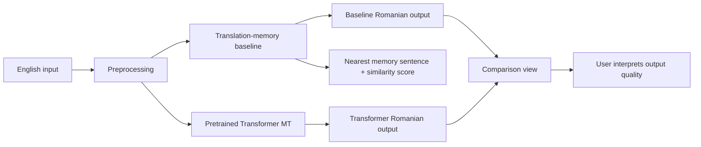

# Practical Project Documentation

## Project Title

**English-to-Romanian Machine Translation: Comparing a Translation-Memory Baseline with a Transformer Model**

---

# 1. Problem Statement

This project solves the Natural Language Processing task of **machine translation**. Machine translation is the automatic conversion of text from one natural language into another while preserving meaning, grammar, and fluency.

In this project, the source language is **English** and the target language is **Romanian**. The application receives an English sentence as input and produces a Romanian translation as output.

Formally, the task can be described as:

```text
Input:  English sentence x
Output: Romanian sentence y
Goal:   y should preserve the meaning of x and be grammatical in Romanian
```

For example:

```text
English input:  The students submitted the report yesterday.
Romanian output: Studentii au prezentat raportul ieri.
```

The project compares two approaches to the same task:

1. a **translation-memory baseline**, which retrieves a translation from stored bilingual examples;
2. a **pretrained Transformer machine translation model**, which generates a Romanian translation.

The main practical question is:

**How does a simple retrieval-based translation-memory baseline compare with a pretrained Transformer model for English-to-Romanian machine translation?**

This comparison is useful because the two methods represent different approaches to translation. The baseline is transparent and easy to inspect, while the Transformer represents modern neural machine translation.

---

# 2. Proposed Solution

The proposed solution is a comparative machine translation system. The same English input is processed by two translation methods, and their outputs are compared.

The two methods are:

- **Method A: Translation-memory baseline**
- **Method B: Pretrained Transformer MT**

The project also includes:

- a dataset loader for English-Romanian parallel text;
- an experiment pipeline;
- automatic evaluation using BLEU and chrF;
- manual error-analysis support;
- a Streamlit application for live comparison.

## 2.1 Theoretical Aspects

### 2.1.1 Machine Translation

Machine translation is commonly modeled as a sequence-to-sequence problem. The system receives a sequence of source-language tokens and produces a sequence of target-language tokens.

For this project:

```text
Source sequence: English words/tokens
Target sequence: Romanian words/tokens
```

A good translation should preserve:

- **semantic meaning**: the same information should be expressed;
- **word relations**: subjects, verbs, objects, time, and modifiers should remain correct;
- **grammar**: the Romanian output should be grammatically valid;
- **fluency**: the output should sound natural enough for a Romanian reader.

### 2.1.2 Method A: Translation-Memory Baseline

A translation memory is a retrieval-based translation system. It stores bilingual sentence pairs that have already been translated. When a new sentence is entered, the system searches for the most similar stored source sentence and returns its paired target-language translation.

In this project, the memory contains English-Romanian pairs:

```text
English memory sentence -> Romanian memory translation
```

The baseline does not generate new Romanian text. It only retrieves a Romanian sentence that already exists in memory.

The implemented baseline follows this process:

```text
English input
-> text feature extraction
-> TF-IDF vector representation
-> cosine similarity against memory sentences
-> nearest English memory sentence
-> paired Romanian translation
```

#### Text Features

The baseline converts English sentences into features. The implementation uses:

- unigrams;
- bigrams;
- trigrams;
- character n-grams of length 3, 4, and 5.

This allows the system to compare both whole-word patterns and smaller character-level patterns.

#### TF-IDF

TF-IDF means **term frequency - inverse document frequency**.

It gives weight to features according to how informative they are:

- a feature that appears often in a sentence receives higher term frequency;
- a feature that appears in many different sentences is less distinctive;
- a feature that is rarer across the memory can be more useful for matching.

The implemented IDF formula is:

```python
idf = log((1 + number_of_documents) / (1 + document_frequency)) + 1
```

This is used to build TF-IDF vectors for the memory sentences and for the new input sentence.

#### Cosine Similarity

Cosine similarity compares two vectors by measuring how similar their direction is. If the input sentence and a memory sentence have similar features, their cosine similarity score is higher.

The score is between 0 and 1 in this application context:

```text
0   = not similar
1   = very similar
```

The baseline selects the memory sentence with the highest cosine similarity.

#### Reliability Threshold

The baseline uses a similarity threshold of `0.42`.

If the best similarity score is below the threshold, the system does not return the Romanian translation. Instead, it reports that no reliable memory match was found.

This prevents the baseline from returning a misleading translation when the closest stored sentence is still not close enough to the user input.

#### Strengths

- easy to understand;
- transparent;
- implemented from scratch;
- shows the nearest memory sentence;
- shows the similarity score;
- works well when the input is close to a stored example.

#### Weaknesses

- cannot generate new translations;
- depends heavily on the memory dataset;
- fails when no close sentence exists;
- may abstain if the similarity score is too low.

### 2.1.3 Method B: Pretrained Transformer Machine Translation

The second method uses the pretrained model:

```text
Helsinki-NLP/opus-mt-en-ro
```

This is a neural machine translation model based on the Transformer sequence-to-sequence approach.

The Transformer architecture was introduced by Vaswani et al. in **"Attention Is All You Need"**. Its central idea is **attention**, which allows the model to focus on relevant parts of the input sentence when generating each part of the output sentence.

For machine translation, this is important because English and Romanian do not always use the same word order. Attention helps the model connect source-language words with the target-language words they influence.

The Transformer process can be described as:

```text
English sentence
-> tokenizer
-> encoder-decoder Transformer model
-> generated Romanian tokens
-> decoded Romanian sentence
```

The model is not trained from scratch in this project. Instead, the pretrained Hugging Face model is loaded and used for comparison against the baseline.

#### Encoder-Decoder View

The encoder reads the English sentence and builds contextual representations. The decoder then generates the Romanian sentence step by step.

```text
Encoder: reads English input
Decoder: generates Romanian output
```

Unlike the translation-memory baseline, the Transformer can produce a new translation even when the exact English sentence was not stored in a memory file.

#### Beam Search

The implementation uses beam search with `num_beams=4`. Beam search keeps several possible translation candidates during generation and chooses a stronger final output than simple greedy decoding.

#### Strengths

- generates new translations;
- handles unseen input better than retrieval;
- uses contextual information;
- represents modern neural machine translation.

#### Weaknesses

- requires downloading a pretrained model;
- requires more computation than the baseline;
- is less transparent than translation memory;
- can still make errors in meaning, grammar, word order, or named entities.

## 2.2 Data Set Used In Application - Description/Analysis

The dataset used for the full project is:

```text
Helsinki-NLP/opus-100
Configuration: en-ro
```

Dataset link:

https://huggingface.co/datasets/Helsinki-NLP/opus-100

The dataset is a **parallel corpus**, meaning that each example contains aligned sentences in two languages.

Each example has the structure:

```python
translation["en"]  # English source sentence
translation["ro"]  # Romanian reference translation
```

The dataset is loaded in:

```text
src/mt_practical/data.py
```

using:

```python
load_dataset("Helsinki-NLP/opus-100", "en-ro")
```

### How The Dataset Is Used

The implemented pipeline uses the dataset splits as follows:

- **train split**: used to create the translation-memory database;
- **test split**: used to evaluate both translation systems.

The current implementation does not fine-tune the Transformer model and does not use the validation split for tuning. A validation split could be used in future work to tune the baseline threshold or other parameters, but the present implementation focuses on train-memory construction and test-set evaluation.

### Default Experiment Size

The default full experiment uses:

```text
2,000 training examples for translation memory
300 test examples for evaluation
seed = 7
```

This size was chosen because it is manageable for local execution while still being large enough to show the difference between retrieval-based translation and neural generation.

### Role Of The Romanian Reference

The Romanian sentence from the dataset is the **reference translation**. It is used for evaluation.

Automatic metrics such as BLEU and chrF require a reference translation. That is why BLEU and chrF are calculated in the experiment pipeline, where test references are available, and not directly for arbitrary user input in the live app.

## 2.3 Application

The application is a Streamlit interface that allows a user to enter an English sentence and compare two Romanian outputs.

Application file:

```text
src/mt_practical/app.py
```

Run command:

```powershell
streamlit run src\mt_practical\app.py
```

### Application Diagram



### Application Behavior

The user enters an English sentence. The same sentence is sent to both systems.

For the translation-memory baseline, the app:

1. loads `data/processed/memory_train.csv`;
2. fits the translation-memory baseline;
3. finds the nearest English memory sentence;
4. checks the similarity threshold;
5. displays the Romanian output if the match is reliable;
6. displays the nearest memory sentence and similarity score;
7. shows the top memory candidates in an expandable table.

For the Transformer model, the app:

1. loads `Helsinki-NLP/opus-mt-en-ro`;
2. tokenizes the English input;
3. generates Romanian tokens;
4. decodes the tokens into Romanian text;
5. displays the generated translation.

### App Versus Evaluation Pipeline

The app is mainly a demonstration and comparison interface. It does not compute BLEU or chrF for arbitrary user input because the user input does not come with a Romanian reference translation.

The formal evaluation is done in the experiment pipeline, where the OPUS-100 test set provides reference translations.

---

# 3. Implementation - Details

The project is implemented as a Python package with separate modules for data loading, baseline translation, Transformer translation, evaluation, experiment running, and the application.

## 3.1 Project Structure

```text
practical-mt-project/
  src/mt_practical/
    data.py
    baseline.py
    transformer_mt.py
    metrics.py
    pipeline.py
    app.py
  data/
    sample/
    processed/
  outputs/
  report/
```

## 3.2 Main Libraries

The main libraries used are:

- `datasets`: loads the OPUS-100 dataset from Hugging Face;
- `transformers`: loads the pretrained Transformer tokenizer and model;
- `torch`: runs the neural model;
- `sentencepiece`: supports tokenization for the Helsinki-NLP model;
- `sacrebleu`: computes BLEU and chrF;
- `streamlit`: builds the live application;
- `pandas`: reads CSV files and displays tables;
- Python standard libraries such as `csv`, `json`, `math`, `re`, `pathlib`, and `collections`.

## 3.3 Data Loading

Implemented in:

```text
src/mt_practical/data.py
```

Important function:

```python
load_opus100_en_ro(train_size, test_size, seed)
```

This function loads the dataset, selects a fixed number of examples, and returns English-Romanian sentence pairs.

It extracts examples using:

```python
item = row["translation"]
en = item.get("en", "").strip()
ro = item.get("ro", "").strip()
```

The processed data is saved as:

```text
data/processed/memory_train.csv
data/processed/test.csv
```

## 3.4 Baseline Implementation

Implemented in:

```text
src/mt_practical/baseline.py
```

Main class:

```python
TranslationMemoryBaseline
```

Important functions:

- `tokenize(text)`: lowercases and tokenizes English text;
- `make_features(text)`: creates unigram, bigram, trigram, and character n-gram features;
- `cosine(a, b)`: computes cosine similarity;
- `fit(sources, targets)`: stores English-Romanian memory pairs and builds TF-IDF vectors;
- `predict_one(source)`: finds the nearest memory sentence and returns a prediction;
- `predict_many(sources)`: applies prediction to multiple test sentences.

The baseline prediction object includes:

- input source;
- output translation;
- nearest source sentence;
- similarity score;
- reliability flag;
- top memory candidates.

## 3.5 Transformer Implementation

Implemented in:

```text
src/mt_practical/transformer_mt.py
```

Main class:

```python
TransformerTranslator
```

The model is loaded using:

```python
AutoTokenizer.from_pretrained(model_name)
AutoModelForSeq2SeqLM.from_pretrained(model_name)
```

The translation function tokenizes the input, runs model generation, and decodes the output:

```python
inputs = tokenizer([text], return_tensors="pt", padding=True, truncation=True)
generated = model.generate(**inputs, max_new_tokens=max_new_tokens, num_beams=4)
translation = tokenizer.batch_decode(generated, skip_special_tokens=True)[0]
```

## 3.6 Evaluation Implementation

Implemented in:

```text
src/mt_practical/metrics.py
```

Main function:

```python
evaluate(predictions, references)
```

When `sacrebleu` is installed, the implementation uses:

```python
sacrebleu.corpus_bleu(predictions, [references]).score
sacrebleu.corpus_chrf(predictions, [references]).score
```

The file also includes fallback demo metrics in case `sacrebleu` is not installed. For final evaluation, `sacrebleu` should be used.

## 3.7 Experiment Pipeline

Implemented in:

```text
src/mt_practical/pipeline.py
```

The pipeline controls the full experiment:

1. loads the dataset;
2. writes the memory and test CSV files;
3. fits the translation-memory baseline;
4. runs baseline predictions;
5. runs Transformer predictions unless skipped;
6. writes prediction results;
7. computes BLEU and chrF;
8. creates an error-analysis template.

Important output files:

```text
outputs/predictions.csv
outputs/metrics.json
outputs/error_analysis_template.csv
```

## 3.8 Streamlit Application

Implemented in:

```text
src/mt_practical/app.py
```

The app loads the baseline memory from:

```python
MEMORY_PATH = ROOT / "data" / "processed" / "memory_train.csv"
```

It displays:

- translation-memory output;
- Transformer output;
- nearest memory source;
- similarity score;
- top memory candidates.

---

# 4. Experiments And Results

## 4.1 Experimental Setup

The experiment compares:

1. **Translation-memory baseline**
2. **Pretrained Transformer MT**

Both systems are tested on the same English sentences from the OPUS-100 `en-ro` test split.

The default full setup is:

```text
training/memory examples: 2,000
test examples: 300
model: Helsinki-NLP/opus-mt-en-ro
metrics: BLEU and chrF
manual analysis: first 30 examples prepared for inspection
```

## 4.2 Commands

### Sample Mode

Sample mode runs without internet and can be used to verify that the pipeline works:

```powershell
python -m mt_practical.pipeline --sample --skip-transformer
```

This verifies:

- data loading;
- baseline fitting;
- prediction writing;
- metrics-file creation;
- error-template creation.

### Full Experiment

The full experiment requires installing dependencies and downloading the dataset and model:

```powershell
python -m pip install -r requirements.txt
python -m pip install -e .
python -m mt_practical.pipeline --train-size 2000 --test-size 300
```

Then the app can be started with:

```powershell
streamlit run src\mt_practical\app.py
```

## 4.3 Evaluation Metrics

### BLEU

BLEU measures word and phrase overlap between the system translation and the Romanian reference translation.

In this project, BLEU answers:

```text
How much does the system output overlap with the human Romanian reference at word and n-gram level?
```

### chrF

chrF measures character-level similarity between the system output and the reference translation.

This is useful for Romanian because Romanian morphology can involve word endings and character-level changes. chrF can capture partial similarity even when words are not exactly identical.

### Manual Error Analysis

Automatic metrics do not fully explain translation quality. Therefore, the pipeline creates:

```text
outputs/error_analysis_template.csv
```

This file is used to manually inspect errors such as:

- missing meaning;
- wrong word order;
- grammar error;
- morphology error;
- named-entity error;
- unrelated baseline retrieval;
- fluent but semantically incorrect translation.

The code creates the template automatically, but the actual error labels and notes are filled manually.

## 4.4 Generated Output Files

The experiment produces:

### `outputs/predictions.csv`

Contains:

- English source sentence;
- Romanian reference translation;
- baseline output;
- nearest baseline memory sentence;
- baseline similarity score;
- baseline reliability flag;
- Transformer output.

### `outputs/metrics.json`

Contains:

- dataset name;
- train size;
- test size;
- BLEU and chrF for the baseline;
- BLEU and chrF for the Transformer if the Transformer was run.

### `outputs/error_analysis_template.csv`

Contains rows for manual evaluation and notes.

## 4.5 Expected Results And Interpretation

The expected result is that the Transformer model should usually perform better on unseen sentences because it can generate new translations.

The translation-memory baseline should perform well only when the input sentence is close to a stored sentence. If the input is not close to the memory, the baseline either abstains or produces a weak result.

This difference is central to the project:

```text
Translation memory = retrieval from stored examples
Transformer MT     = neural generation of new translations
```

The baseline is still important because it gives a transparent comparison point. It shows what a simple retrieval method can do, and it makes the advantage of neural generation easier to explain.

## 4.6 Limitations

The project has the following limitations:

- the Transformer model is pretrained, not trained from scratch;
- the baseline depends strongly on memory coverage;
- the selected train and test sizes are limited for local execution;
- BLEU and chrF do not capture all aspects of human translation quality;
- manual error analysis requires human inspection;
- full execution requires downloading the OPUS-100 dataset and the pretrained model.

## 4.7 Possible Future Improvements

Future improvements could include:

- using a larger memory database;
- tuning the similarity threshold on validation data;
- adding sentence embeddings for a stronger retrieval baseline;
- fine-tuning the Transformer on English-Romanian data;
- adding a learned MT evaluation metric such as COMET;
- expanding the manual error analysis to more examples.

## 4.8 Conclusion

This project demonstrates a complete practical NLP workflow for English-to-Romanian machine translation. It includes data loading, a transparent baseline, a pretrained Transformer model, a live application, automatic evaluation, and manual error-analysis support.

The main conclusion is that the Transformer model is expected to be stronger for new and unseen input because it can generate translations, while the translation-memory baseline is limited to retrieving stored translations. However, the baseline remains useful because it is interpretable and provides a clear comparison point for evaluating the neural model.
